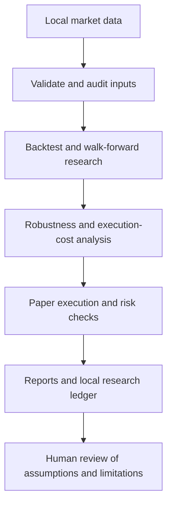

# ARASH Foundation

**Systematic trading research · Offline-first simulation · Explicit risk controls**

*An auditable foundation for market-data validation, quantitative experiments, paper execution, portfolio-risk diagnostics, and reproducible research evidence.*

---

> **Repository status:** The public repository is being prepared using the supplied **ARASH Foundation 28.0.0** archive as the reference snapshot. The source archive has been reviewed for obvious credential patterns and sensitive filenames, but its source tree has **not yet been synchronized into this GitHub repository**. Therefore, this repository is currently documentation-only and is not yet installable or runnable from GitHub.

## What is ARASH?

ARASH is an offline-first software foundation for systematic trading research. Its goal is to make experiments inspectable and repeatable while keeping data quality, transaction costs, risk assumptions, and missing evidence visible.

The project does not promise returns. It aims to help developers evaluate trading hypotheses without confusing a backtest, a paper fill, or a passing software test with proof of a profitable strategy.

## Capabilities in the 28.0.0 reference archive

- **Market-data ingestion and quality:** local candle-file loading, structural checks, data-health diagnostics, and market-data workflows.
- **Historical research:** offline backtesting, walk-forward evaluation, strategy comparison, robustness analysis, and quantitative audits where supported.
- **Paper execution:** local simulated order handling, execution-friction assumptions, order lifecycle tests, and simulated portfolio state.
- **Risk engine:** position sizing, portfolio exposure controls, valuation-mark freshness checks, portfolio stress diagnostics, and risk-related CLI workflows.
- **Research persistence and reporting:** SQLite-backed local storage, machine-readable outputs, and reproducible diagnostic records.
- **Safety boundaries:** the reference snapshot is designed for research and paper simulation; its release evidence records that no live orders were submitted.

These are capabilities documented by the 28.0.0 source archive. They have **not yet been verified by running code from this GitHub checkout**, because the source files are not present here yet.

## Research workflow

## Risk and research integrity

1. Keep evaluation data chronologically separate from strategy selection and tuning.
2. Declare the dataset, configuration, benchmark, and transaction-cost assumptions.
3. Treat simulated orders and fills as simulated—not as exchange activity.
4. Keep missing or unavailable checks marked as incomplete.
5. Do not infer profitability from backtests, test counts, or software quality gates.
6. Never commit API credentials, personal account data, local ledgers, or private datasets.

Read the [Architecture](docs/ARCHITECTURE.md), [Research Protocol](docs/RESEARCH_PROTOCOL.md), and [Risk and Safety Policy](docs/RISK_AND_SAFETY.md).

## Verification reported for version 28.0.0

The archive's recorded release gate reports:

| Check | Recorded result |
|---|---|
| Automated tests | 301 passed across 10 pytest groups |
| Smoke checks | 11/11 passed |
| Python compilation | Passed |
| Wheel build and isolated install/import | Passed |
| Ruff lint | Unavailable; not counted as a pass |
| Python 3.12 and hosted CI | Not independently verified |
| Overall release gate | **INCOMPLETE** — 24 passed, 0 failed, 1 incomplete |

These are archive-reported results dated 2026-10-16, not CI results for this GitHub repository. The full details and limitations are in [Release and Verification Status](docs/RELEASE_STATUS.md).

## Documentation

- [Architecture and component boundaries](docs/ARCHITECTURE.md)
- [Research and validation protocol](docs/RESEARCH_PROTOCOL.md)
- [Risk controls and safety boundary](docs/RISK_AND_SAFETY.md)
- [Release and verification status](docs/RELEASE_STATUS.md)
- [Roadmap](ROADMAP.md)
- [Changelog](CHANGELOG.md)
- [Contributing guide](CONTRIBUTING.md)
- [Security reporting](SECURITY.md)

## Source publication status

The next repository milestone is to synchronize the reviewed source, tests, packaging metadata, configuration examples, sample data, and CI workflow from the 28.0.0 archive. After synchronization, the complete release gate must be rerun from a clean checkout before installation or release readiness is claimed.

## Disclaimer

ARASH is a software and quantitative-research project, not financial advice. Backtests and paper simulations are sensitive to input quality, assumptions, model selection, and execution costs. They do not guarantee future results.

**Current boundary: offline research and paper simulation only. No live-order execution is claimed or authorized by this repository.**
