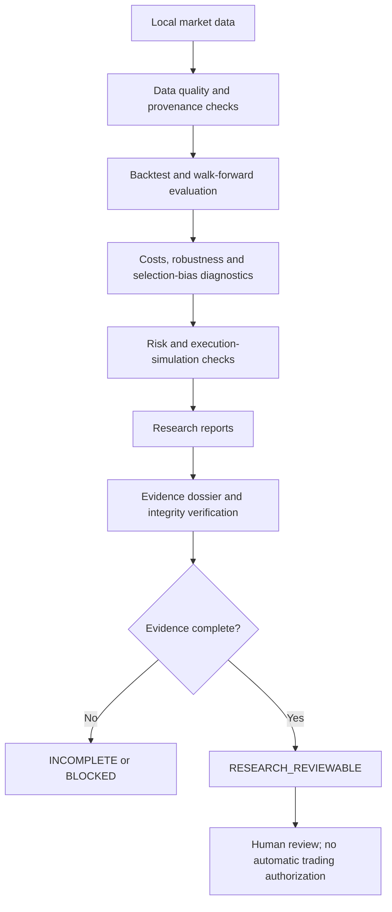

# ARASH Foundation

**Evidence-driven trading research. Deterministic offline simulation. Explicit risk controls.**

*A research foundation designed to make trading experiments inspectable, risk-aware, reproducible, and honest about uncertainty.*

---

> **Repository status:** This repository is currently the public documentation layer for ARASH Foundation. The ARASH Foundation 30.0.0 source archive has not yet been mirrored into this GitHub tree, so this repository is **not currently an installable or runnable distribution**. The test and release figures below come from the separately recorded 30.0.0 archive report; they are not CI results for this repository revision.

## What ARASH is

ARASH is an offline-first software foundation for systematic trading research. It brings market-data validation, historical analysis, execution simulation, risk controls, quantitative diagnostics, and research-evidence verification into a single, auditable workflow.

The design objective is not to promise returns. It is to make it harder for a research result to look more trustworthy than its data, assumptions, validation, or evidence justify.

## Core capabilities in the 30.0.0 reference snapshot

- **Market-data quality:** validate candle files and temporal structure, flag stale or degraded inputs, and retain provenance for imported research data.
- **Historical strategy evaluation:** run offline backtests and walk-forward research with explicit assumptions rather than treating an in-sample result as proof of future performance.
- **Execution-friction modeling:** account for configurable fees, spread, slippage, market impact, bar capacity, and partial fills in paper simulations.
- **Quantitative diagnostics:** compare declared candidate families against a baseline, examine out-of-sample results, and include multiple-testing or selection-bias diagnostics where supported.
- **Risk controls:** evaluate position sizing, portfolio exposure, daily-loss limits, drawdown limits, and the freshness of valuation inputs.
- **Paper-trading boundaries:** keep simulated orders distinct from real exchange orders. The 30.0.0 reference snapshot reports no live order-execution capability.
- **Sealed research evidence:** assemble a dossier from local JSON reports, bind artifacts to byte-level SHA-256 fingerprints, inspect provenance and validation evidence, and verify that referenced files have not changed.
- **Local persistence:** use a SQLite-backed research ledger and machine-readable reports where supported by the source snapshot.

These are capabilities reported for the 30.0.0 reference archive, not a claim that the code has already been published into this repository. See [Release and Verification Status](docs/RELEASE_STATUS.md).

## Research workflow

`RESEARCH_REVIEWABLE` means the configured evidence checklist was satisfied. It does **not** mean a strategy has a profitable edge, is safe for live execution, or is authorized to trade.

## Research integrity principles

1. **No look-ahead by design:** preserve chronological separation between training, selection, and evaluation wherever the research method requires it.
2. **One declared dataset identity:** results from semantically different datasets must not be combined as if they were the same experiment.
3. **Costs matter:** a result should be challenged under realistic transaction-cost and execution-friction assumptions.
4. **Missing evidence stays missing:** absent checks must remain incomplete; they must not silently become passes.
5. **Integrity is not authenticity:** a matching hash detects byte changes; by itself it does not prove who created a file or whether its claims are true.
6. **Research is not execution approval:** favorable diagnostics never enable live trading by implication.

More detail: [Architecture](docs/ARCHITECTURE.md), [Research Protocol](docs/RESEARCH_PROTOCOL.md), and [Risk and Safety](docs/RISK_AND_SAFETY.md).

## Command-line surface in the reference snapshot

The recorded 30.0.0 snapshot includes commands such as:

- `arash research-evidence` — build an evidence dossier from local JSON research reports.
- `arash verify-research-evidence` — verify a dossier and the exact identity of its supplied artifacts.
- `arash quant-audit` — produce bounded quantitative research diagnostics without authorizing an order.

The evidence command accepts up to 12 local JSON reports and applies a 10 MiB per-report input limit in the recorded implementation. Because source files are not yet present in this GitHub tree, these commands cannot be installed or run from this repository yet.

## Verification reported for the 30.0.0 archive

| Check | Reported result | Interpretation |
|---|---:|---|
| Automated tests | 310 passed across 10 isolated groups | Reported local test result |
| Local smoke checks | 12/12 passed | No live orders were submitted |
| Python compilation | Passed | Reported for the archive |
| Wheel build and isolated install/import | Passed | Reported for the archive |
| Ruff lint check | Incomplete / unavailable | Ruff was not installed |
| Python 3.12 and hosted CI | Not verified | Independent CI evidence is still needed |
| Overall release gate | **INCOMPLETE** | 25 passed, 0 failed, 1 incomplete |

These numbers are transcribed from the recorded 30.0.0 test and release-gate reports dated 2026-10-16. They have not been re-run against this documentation-only GitHub tree. The project deliberately retains the `INCOMPLETE` release status rather than presenting partial evidence as a clean release.

## Documentation

- [Architecture and component boundaries](docs/ARCHITECTURE.md)
- [Research and validation protocol](docs/RESEARCH_PROTOCOL.md)
- [Risk controls and safety boundary](docs/RISK_AND_SAFETY.md)
- [Release and verification status](docs/RELEASE_STATUS.md)
- [Roadmap](ROADMAP.md)
- [Changelog](CHANGELOG.md)
- [Contributing guide](CONTRIBUTING.md)
- [Security reporting](SECURITY.md)

## Source and installation

The source snapshot needs to be reviewed, sanitized, and synchronized into this repository before installation instructions can be responsibly published. No placeholder install command is provided because this tree does not yet contain the package metadata, source modules, or tests needed to validate one.

Once the source is mirrored, the next verification step is to reproduce the archive checks from a clean checkout, run the full release gate, install Ruff, and add hosted CI coverage for the supported Python versions.

## Scope and disclaimer

ARASH is a software engineering and quantitative-research project. Backtests and simulations are sensitive to data quality, assumptions, model selection, and execution costs. Historical or synthetic results are not a guarantee of future performance. This project is not financial advice, and the public repository must not be interpreted as an endorsement to trade real capital.

**Current operating boundary: offline research and paper simulation only. No live-order execution is provided or validated by the 30.0.0 reference snapshot.**