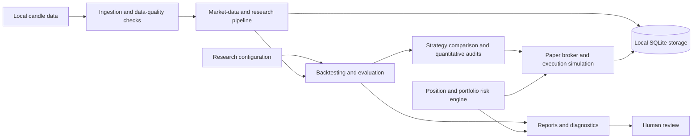

# ARASH Foundation — Architecture

## Purpose

ARASH is organized around inspectable research inputs, explicit simulation assumptions, and visible risk boundaries. This document describes the logical component areas represented in the ARASH Foundation 28.0.0 reference archive. The current GitHub repository has not yet received the source tree, so this is an architecture overview rather than proof that the repository is runnable.

## Logical component map

## Component responsibilities

### Market data and quality

The archive includes local CSV loading, candle-oriented workflows, data-health checks, and validation tests. Data should be checked for malformed fields, invalid or unordered timestamps, duplicate records, gaps, stale values, and mixed symbol or interval assumptions before downstream evaluation.

### Research and evaluation

Backtesting, walk-forward analysis, strategy comparison, robustness checks, and quantitative audits help examine hypotheses. Evaluation windows should remain separate from strategy selection and parameter tuning. A passing test or favorable backtest does not establish future profitability.

### Paper execution

The paper broker models simulated order behavior and local portfolio state. Fees, spread, slippage, capacity, partial fills, and other execution assumptions should be explicit wherever supported. Simulated fills are not evidence that a real venue would execute the same way.

### Risk engine

The 28.0.0 change record highlights a correction to incremental position sizing: existing exposure in the same instrument is considered before sizing an additional BUY. The reference archive also contains portfolio exposure, mark-freshness, and stress-analysis components. These are software controls, not guarantees against loss.

### Persistence and reporting

The reference source includes a SQLite-backed local store and machine-readable research or risk outputs. Local ledgers and generated reports may contain sensitive or machine-specific data and should not be published by default.

## Trust boundaries

- **Data boundary:** only declared inputs should be assumed available in an offline run.
- **Simulation boundary:** simulated orders must never be presented as real exchange activity.
- **Risk boundary:** risk checks reduce certain classes of operational error but cannot eliminate market risk.
- **Evidence boundary:** test results apply to the recorded environment and source revision only.
- **Repository boundary:** source synchronization and clean-checkout verification remain outstanding.

## Release limitations

The 28.0.0 release gate is recorded as `INCOMPLETE`: Ruff was unavailable, and Python 3.12 plus hosted CI were not independently verified. See [Release and Verification Status](RELEASE_STATUS.md).
