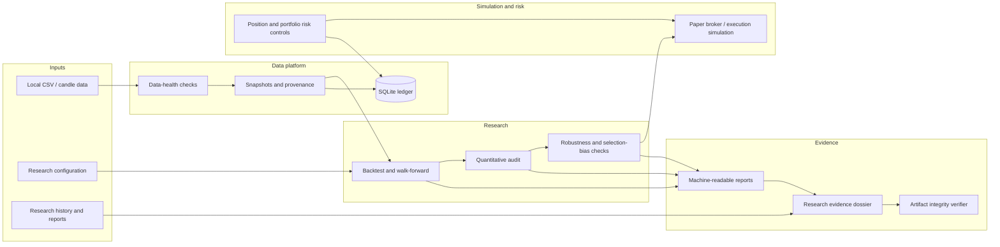

# ARASH Foundation — Architecture

## Purpose

ARASH organizes systematic-trading research around a simple rule: every result should be traceable to its inputs, assumptions, validation method, and limitations. The architecture below describes the component boundaries evidenced by the ARASH Foundation 30.0.0 reference snapshot. It is a logical architecture, not a guarantee that this repository currently contains those source files.

## Logical component map



## Component responsibilities

### 1. Data validation and provenance

Incoming candle data should be checked before it is accepted for research. Relevant conditions include missing or malformed fields, invalid timestamps, duplicated or out-of-order candles, mixed symbols or intervals, gaps, stale values, and inconsistent snapshot provenance. A warning must be distinguishable from a structural blocker; downstream tools should not silently turn a blocked input into a usable dataset.

### 2. Research and historical evaluation

Backtesting, walk-forward evaluation, and strategy comparison are research tools, not live-performance guarantees. Evaluation windows should be chronological and separated from the data used to choose a strategy. Baselines and declared candidate families make comparisons more interpretable. Where supported, reports should record configuration identity and dataset identity so that different experiments cannot be merged casually.

### 3. Execution simulation

The paper execution layer models order lifecycles and execution friction locally. The reference snapshot reports configurable fees, spread, slippage, market impact, bar-volume participation, limited order lifetime, and partial fills. Simulation details must remain visible in the output; a modeled fill is not evidence that a real venue would fill an order in the same way.

### 4. Risk controls

Risk checks cover position sizing, single-position limits, aggregate exposure, daily loss, drawdown, and valuation-mark freshness. Risk outputs are explicit diagnostics or blocking decisions. They do not eliminate market risk and must not be treated as a reason to assume a trade is safe.

### 5. Reports and evidence

Research results are written as machine-readable artifacts. The evidence engine can assemble a dossier from up to 12 local JSON reports, inspect recognized categories of research evidence, and bind artifacts to SHA-256 identities. A verifier checks the dossier and supplied artifact identities. This gives reproducible integrity checks, but hashes alone do not authenticate data origins, experiment authors, or economic conclusions.

## Data flow and failure semantics

```text
Validate inputs
    -> preserve dataset/configuration identity
    -> run research with chronological evaluation
    -> challenge results with transaction costs and bias diagnostics
    -> record risk and execution-simulation assumptions
    -> emit machine-readable reports
    -> assemble and verify the evidence dossier
    -> review the resulting status and limitations
```

Missing or contradictory evidence must be reported as incomplete or blocked rather than inferred to be valid. A successful verifier only establishes the checks its output names; it is not a universal proof of correctness.

## Trust boundaries

- **Data boundary:** only explicit local inputs should be assumed available in an offline run.
- **Simulation boundary:** simulated orders and fills must never be described as real exchange activity.
- **Evidence boundary:** report fingerprints provide integrity checks, not provenance authenticity or statistical truth.
- **Decision boundary:** no research score or evidence status should implicitly activate real order execution.
- **Repository boundary:** the current GitHub tree is still awaiting source synchronization, so architecture docs do not make it runnable.

## Known release limitations

The 30.0.0 release record reports that Ruff was unavailable and that Python 3.12 plus hosted CI were not verified. The complete release gate therefore remains `INCOMPLETE`. See [Release and Verification Status](RELEASE_STATUS.md).